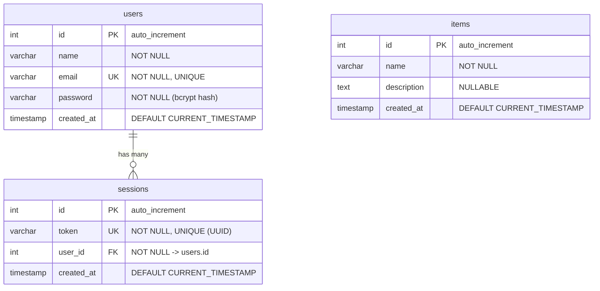

# Backend REST API (Bun + ElysiaJS + Drizzle ORM + MySQL)

Repositori ini merupakan implementasi backend RESTful API modern, cepat, dan aman yang dibangun menggunakan runtime **Bun**, framework **ElysiaJS**, serta **Drizzle ORM** dengan database relasional **MySQL**.

Aplikasi ini menyediakan fitur autentikasi pengguna berbasis sesi token (Registrasi dengan enkripsi bcrypt, Login multi-sesi dengan token UUID, Endpoint Current User terproteksi, dan Logout) serta modul CRUD sederhana untuk pengelolaan data Items.

---

## 🛠️ Teknologi Stack & Library

| Kategori | Teknologi / Library | Deskripsi & Kegunaan |
|---|---|---|
| **Runtime & Package Manager** | [Bun](https://bun.sh/) (v1.0+) | JavaScript/TypeScript runtime all-in-one berkecepatan tinggi |
| **Web Framework** | [ElysiaJS](https://elysiajs.com/) (v1.4+) | Framework web berperforma tinggi untuk Bun dengan validasi skema otomatis |
| **ORM** | [Drizzle ORM](https://orm.drizzle.team/) | TypeScript ORM yang *type-safe* dan ringan |
| **Database Migration Tool** | [Drizzle Kit](https://orm.drizzle.team/kit-docs/overview) | CLI generator migrasi SQL dan sinkronisasi skema |
| **Database Driver** | [MySQL2](https://github.com/sidorares/node-mysql2) | Driver koneksi MySQL berbasis promise/connection pool |
| **Password Hashing** | `Bun.password` (Native bcrypt) | Enkripsi satu arah untuk keamanan password pengguna (cost: 10) |
| **Token & Session** | UUID v4 (`crypto.randomUUID()`) | Token sesi unik untuk autentikasi Bearer token |
| **Bahasa & Type Checking** | TypeScript (v5+) | Menjamin *type-safety* di seluruh layer aplikasi |
| **Test Runner** | Bun Test (`bun:test`) | Unit & integration test runner bawaan Bun |

---

## 🏗️ Arsitektur Aplikasi & Struktur File

Aplikasi ini menerapkan arsitektur berlapis (*layered architecture*) yang memisahkan tanggung jawab antara layer routing, logika bisnis, dan interaksi basis data.

```text
.
├── drizzle/                  # File migrasi SQL hasil generate Drizzle Kit
│   ├── 0000_*.sql
│   ├── 0001_*.sql
│   ├── 0002_*.sql
│   ├── 0003_*.sql
│   └── meta/                 # Metadata snapshot skema Drizzle
├── src/
│   ├── db/                   # Layer Database
│   │   ├── index.ts          # Inisialisasi MySQL connection pool & Drizzle client
│   │   └── schema.ts         # Deklarasi skema tabel Drizzle & export TypeScript types
│   ├── routes/               # Layer Routing & HTTP Controller
│   │   ├── items.ts          # Route handler untuk modul Items (/items)
│   │   └── users-route.ts    # Route handler untuk modul Users (/api/users/*)
│   ├── services/             # Layer Business Logic
│   │   └── users-service.ts  # Logika bisnis: hashing password, verifikasi kredensial, sesi
│   └── index.ts              # Application entry point & mounting seluruh route
├── tests/                    # Layer Pengujian Terpusat (Integration & Unit Tests)
│   ├── test-helper.ts        # Helper pembersihan database antar skenario pengujian
│   ├── health.test.ts        # Test untuk endpoint GET /
│   ├── items.test.ts         # Test skenario lengkap untuk modul Items
│   ├── users.test.ts         # Test integrasi skenario registrasi, login, current, logout
│   └── users-service.test.ts # Test unit untuk hashing bcrypt & error classes
├── .env                      # File konfigurasi environment lokal (diabaikan oleh git)
├── .env.example              # Template konfigurasi environment
├── drizzle.config.ts         # Konfigurasi Drizzle Kit CLI
├── package.json              # Definisi dependensi & skrip eksekusi
├── tsconfig.json             # Konfigurasi compiler TypeScript
└── README.md                 # Dokumentasi project
```

### Konvensi Penamaan File & Pemisahan Layer:
- **Routing Layer (`src/routes/*-route.ts` atau `routes/<module>.ts`)**:
  Bertanggung jawab menerima HTTP request, memvalidasi format data input (body, header, params) menggunakan schema validator Elysia `t.Object`, mendelegasikan tugas ke Service Layer, dan mengembalikan HTTP status code serta format response yang seragam.
- **Service Layer (`src/services/*-service.ts`)**:
  Tempat seluruh logika bisnis (*business logic*) dijalankan secara murni tanpa terikat langsung ke objek request/response HTTP. Menangani hashing password, pembuatan token UUID, query database via Drizzle, dan melempar *custom domain error* seperti `UserAlreadyExistsError`, `InvalidCredentialsError`, dan `UnauthorizedError`.
- **Database Layer (`src/db/`)**:
  Menyimpan definisi skema tabel Drizzle (`schema.ts`), koneksi database pool (`index.ts`), dan relasi foreign key.

---

## 🗄️ Skema Database & Relasi

Aplikasi menggunakan 3 tabel utama di database MySQL:



### Rincian Kolom Tabel:

1. **`users`**
   - `id` (`INT`, Primary Key, Auto Increment): ID unik pengguna.
   - `name` (`VARCHAR(255)`, NOT NULL): Nama lengkap pengguna.
   - `email` (`VARCHAR(255)`, NOT NULL, UNIQUE): Alamat email unik untuk identifikasi akun.
   - `password` (`VARCHAR(255)`, NOT NULL): Hash kata sandi menggunakan bcrypt (panjang ~60 karakter).
   - `created_at` (`TIMESTAMP`, NOT NULL, Default: `NOW()`): Waktu pembuatan akun.

2. **`sessions`**
   - `id` (`INT`, Primary Key, Auto Increment): ID unik sesi.
   - `token` (`VARCHAR(255)`, NOT NULL, UNIQUE): Token UUID sesi autentikasi.
   - `user_id` (`INT`, NOT NULL, Foreign Key merujuk ke `users.id`): Relasi ke tabel pengguna (mendukung multi-sesi login di berbagai perangkat).
   - `created_at` (`TIMESTAMP`, NOT NULL, Default: `NOW()`): Waktu sesi dibuat.

3. **`items`**
   - `id` (`INT`, Primary Key, Auto Increment): ID unik item.
   - `name` (`VARCHAR(255)`, NOT NULL): Nama item.
   - `description` (`TEXT`, NULL): Deskripsi detail item.
   - `created_at` (`TIMESTAMP`, NOT NULL, Default: `NOW()`): Waktu pembuatan item.

---

## 🚀 Panduan Setup Project

### 1. Prasyarat Sistem
- [Bun](https://bun.sh/) (versi 1.0.0 atau lebih baru) terpasang di komputer Anda.
- Server database **MySQL** yang sedang berjalan (dapat menggunakan **Laragon**, **XAMPP**, **Docker**, atau MySQL Server bawaan).

### 2. Kloning Repositori & Instalasi Dependensi
```bash
git clone https://github.com/ArielioBayu/test-vibe-coding.git
cd test-vibe-coding
bun install
```

### 3. Konfigurasi Environment Variables
Salin template konfigurasi dari `.env.example` ke file `.env`:
```bash
cp .env.example .env
```

Buka file `.env` dan sesuaikan URL koneksi database MySQL lokal Anda:
```env
PORT=3000
DATABASE_URL=mysql://root:@localhost:3306/db_belajar_vibe_coding
```
> **Catatan**: Pastikan database (contoh: `db_belajar_vibe_coding`) sudah dibuat di server MySQL Anda sebelum menjalankan migrasi.

### 4. Migrasi Skema ke Database
Gunakan **Drizzle Kit** untuk menerapkan tabel-tabel ke database MySQL:

- **Menerapkan skema langsung ke database (Disarankan untuk dev)**:
  ```bash
  bun run db:push
  ```
- **Membuat file migrasi SQL baru jika ada perubahan skema**:
  ```bash
  bun run db:generate
  ```
- **Membuka antarmuka grafis Drizzle Studio di browser**:
  ```bash
  bun run db:studio
  ```

---

## ▶️ Cara Menjalankan Aplikasi

### Mode Development (Hot Reload)
Menjalankan server lokal dengan fitur auto-reload setiap kali kode sumber diperbarui:
```bash
bun run dev
```
Server akan aktif di: `http://localhost:3000`

### Mode Production
Menjalankan server secara langsung tanpa file watcher:
```bash
bun run start
```

---

## 🧪 Cara Menjalankan Pengujian (Testing)

Proyek ini telah dilengkapi **39 automated tests** komprehensif di dalam folder `tests/` yang mencakup health check, modul items, alur registrasi, autentikasi sesi token, hingga penanganan edge case dan validasi batas input.

Sebelum setiap skenario test dijalankan, helper `clearDatabase()` secara otomatis membersihkan tabel `sessions`, `users`, dan `items` sesuai urutan integritas *Foreign Key*, sehingga hasil pengujian selalu konsisten dan terisolasi.

### Menjalankan Seluruh Test Suite
```bash
bun test
```

### Menjalankan File Test Tertentu
```bash
# Menjalankan test modul Users & Auth saja:
bun test tests/users.test.ts

# Menjalankan test modul Items saja:
bun test tests/items.test.ts

# Menjalankan unit test hashing & helper:
bun test tests/users-service.test.ts
```

### Pengecekan Tipe TypeScript (Typecheck)
Untuk memastikan tidak ada kesalahan tipe data di seluruh file project:
```bash
bun run typecheck
```

---

## 📡 Dokumentasi Endpoint API

### Ringkasan Endpoint

| Method | Endpoint | Autentikasi | Deskripsi Singkat |
|---|---|:---:|---|
| `GET` | `/` | Publik | Health check & status server |
| `GET` | `/items` | Publik | Mengambil daftar seluruh item |
| `POST` | `/items` | Publik | Menambahkan item baru |
| `GET` | `/items/:id` | Publik | Mengambil detail item berdasarkan ID |
| `POST` | `/api/users` | Publik | Registrasi akun pengguna baru |
| `POST` | `/api/users/login` | Publik | Login & mendapatkan Bearer token sesi |
| `POST` | `/api/users/current` | Bearer Token | Mengambil data profil pengguna yang sedang login |
| `DELETE` | `/api/users/logout` | Bearer Token | Logout & menghapus token sesi aktif |

---

### Detail Spesifikasi Request & Response

#### 1. Health Check
- **`GET /`**
  - **Headers**: Tidak ada
  - **Response `200 OK`**:
    ```json
    {
      "status": "ok",
      "message": "Server is running smoothly with Elysia, Drizzle, and MySQL!",
      "timestamp": "2026-11-17T14:00:00.000Z"
    }
    ```

---

#### 2. Items API

- **`GET /items`**
  - Mengambil seluruh item yang ada di database.
  - **Response `200 OK`**:
    ```json
    {
      "success": true,
      "data": [
        {
          "id": 1,
          "name": "Mechanical Keyboard",
          "description": "Tactile switch keyboard",
          "createdAt": "2026-11-17T14:00:00.000Z"
        }
      ]
    }
    ```

- **`POST /items`**
  - Menambahkan item baru.
  - **Request Body**:
    ```json
    {
      "name": "Gaming Mouse",
      "description": "Wireless ultra-light mouse"
    }
    ```
    *Catatan: `name` wajib diisi (1 - 255 karakter), `description` bersifat opsional.*
  - **Response `201 Created`**:
    ```json
    {
      "success": true,
      "message": "Item created successfully",
      "data": [{ "fieldCount": 0, "affectedRows": 1, "insertId": 2 }]
    }
    ```
  - **Response `422 Unprocessable Entity`** (Jika `name` kosong atau > 255 karakter).

- **`GET /items/:id`**
  - Mengambil detail 1 item berdasarkan ID numerik.
  - **Response `200 OK`**:
    ```json
    {
      "success": true,
      "data": {
        "id": 1,
        "name": "Gaming Mouse",
        "description": "Wireless ultra-light mouse",
        "createdAt": "2026-11-17T14:00:00.000Z"
      }
    }
    ```
  - **Response `404 Not Found`**:
    ```json
    {
      "success": false,
      "message": "Item not found"
    }
    ```
  - **Response `400 Bad Request`** (Jika ID berupa teks non-angka).

---

#### 3. Users API (Autentikasi & Akun)

- **`POST /api/users` (Registrasi Akun)**
  - Mendaftarkan user baru dengan email unik. Password otomatis dienkripsi dengan bcrypt.
  - **Request Body**:
    ```json
    {
      "name": "Bayu Aji",
      "email": "bayu@gmail.com",
      "password": "secretpassword123"
    }
    ```
  - **Response `201 Created`**:
    ```json
    {
      "data": "OK"
    }
    ```
  - **Response `400 Bad Request` (Email Duplikat)**:
    ```json
    {
      "error": "Email sudah terdaftar"
    }
    ```
  - **Response `422 Unprocessable Entity`** (Format email tidak valid, field kosong, atau panjang `name`/`email` melebihi 255 karakter).

- **`POST /api/users/login` (Login Pengguna)**
  - Memverifikasi email dan password. Jika cocok, membuat UUID token unik baru yang disimpan di tabel `sessions`.
  - **Request Body**:
    ```json
    {
      "email": "bayu@gmail.com",
      "password": "secretpassword123"
    }
    ```
  - **Response `200 OK`**:
    ```json
    {
      "data": "a3b8e219-c80f-48e2-9b24-b1523f66810c"
    }
    ```
  - **Response `400 Bad Request` (Kredensial Salah)**:
    ```json
    {
      "error": "Email atau password salah"
    }
    ```

- **`POST /api/users/current` (Profil Pengguna Saat Ini)**
  - Mengambil profil akun user pemilik token sesi aktif. Password sengaja dikecualikan dari response.
  - **Headers Wajib**:
    ```http
    Authorization: Bearer <token_uuid_dari_login>
    ```
  - **Response `200 OK`**:
    ```json
    {
      "data": {
        "id": 1,
        "name": "Bayu Aji",
        "email": "bayu@gmail.com",
        "created_at": "2026-11-17T14:00:00.000Z"
      }
    }
    ```
  - **Response `401 Unauthorized`** (Token tidak valid, sesi sudah logout, format header salah, atau header tidak dikirim):
    ```json
    {
      "error": "Unauthorized"
    }
    ```

- **`DELETE /api/users/logout` (Logout Pengguna)**
  - Menghapus record sesi yang cocok dari tabel `sessions`. Token tersebut otomatis hangus dan tidak dapat dipakai lagi.
  - **Headers Wajib**:
    ```http
    Authorization: Bearer <token_uuid_dari_login>
    ```
  - **Response `200 OK`**:
    ```json
    {
      "data": "OK"
    }
    ```
  - **Response `401 Unauthorized`** (Jika token tidak ada di tabel `sessions` atau header tidak valid):
    ```json
    {
      "error": "Unauthorized"
    }
    ```
